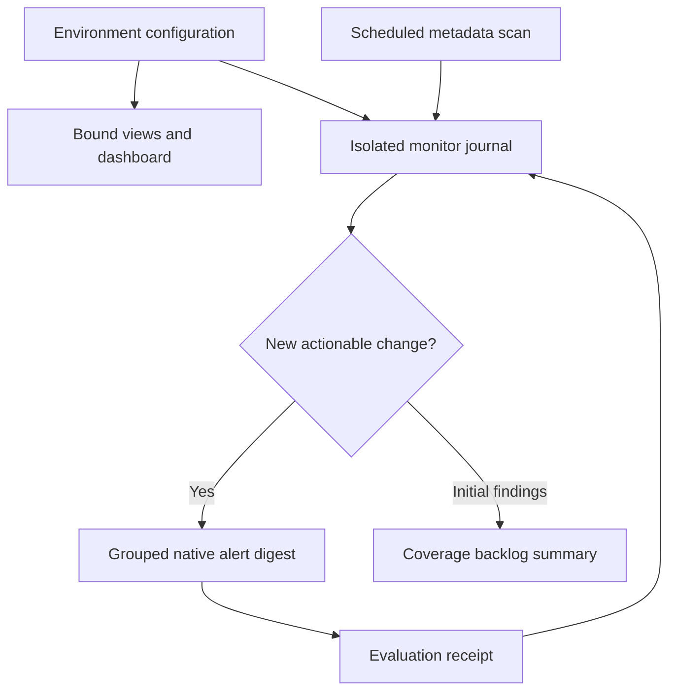

# Architecture and operating contract

## Deployment model

The source code, dashboard layout, logical view names and detection rules are shared across environments. The deployment profile binds source catalogs, schema exclusions, mapping and optional Collate tables, service identity, taxonomy, tag keys, execution workspace, output schema, compute, subscribers and timing. Source configuration is supplied at deployment, not by dashboard viewers.

The scheduled job runs collection, a conditional notification gate, native SQL alert evaluation, then receipt recording. The main alert's own schedule is paused so there are not two independent schedulers dispatching the same batch. A separate health alert runs on a staggered schedule to detect a stopped/failed monitor.

## Scope and state isolation

Monitor identity includes deployment name, environment, expected workspace and output location. A separate scope signature covers catalogs, schema exclusions, reference bindings, service identity, taxonomy and tag keys. Scope changes retain the same monitor identity and fail the baseline signature check rather than silently suppressing new findings by starting over. Different environments have different identities and separate output schemas.

The runtime pins workspace, metastore and metadata-reader identity to the baseline. It fails on zero visible columns, duplicate object identities, missing expected catalog/schema scope or a configured excessive inventory drop. Smaller disappearances create visibility findings; related classification incidents are retained with an evidence-gap state. They are not automatically resolved merely because an asset is no longer visible.

One framework deployment owns the stable logical views in an output schema. The installer rejects a journal belonging to another deployment identity in the same output schema. This prevents a second environment from rebinding those views while an older environment's job still runs.

## Initial backlog and meaningful exceptions

The baseline stores the column inventory and fingerprints of any existing findings. It does not create a separate incident for each initial missing classification. Existing gaps are counted and grouped in the dashboard; targeted metadata corrections remain in the detailed P1/P2 action queue. Unchanged initial findings stay suppressed in monitoring. A finding that clears and later recurs is a new change.

Examples of later incidents:

- A new column remains untagged beyond its first-observed grace period.
- A previously present sensitivity tag disappears.
- A valid assigned tier becomes weaker than its strongest prior observed tier.
- An invalid or conflicting sensitivity value appears.
- New usable mapping evidence requires a stronger or missing sensitivity assignment.
- Matching source mapping rules become inconsistent.

This is classification change monitoring. A weaker-tier event can be an intended change and requires review; it is not automatically a security violation. Legitimate changes must follow the approved governance process. The monitor never downgrades data protection or treats an alert-evaluation receipt as steward approval.

## Digest and notification semantics

Notices have stable IDs based on incident identity, generation, event kind and sequence. Events are carried forward until accepted evaluation receipts are observed. Unchanged open issues do not enqueue another notice while one is pending. Accepted evaluations suppress reminders until the configured interval. A recovery is generated only for an incident that was previously announced; an issue repaired during grace does not generate an email/recovery pair.

A burst of column changes is grouped by responsible owner, catalog/schema/table, event kind and finding. One native evaluation produces a digest to each configured subscriber/destination. The digest includes at most 99 table/finding groups and representative column names; the dashboard holds the complete queue. Event selection is capped per run; remaining events stay pending. This cap limits processing, not the number of separate per-column emails, because that notification mode is not implemented.

A daily coverage summary is one digest item. It reports current aggregate counts and never turns those counts into individual incidents. Daily summary time is UTC in the supplied profile and can be changed.

The alert query is bound to the collector's exact published run ID. A missing/unsupported binding raises a SQL error. Already-receipted notice IDs are excluded from later evaluations. The notification task has no automatic retry; failed evaluations leave events pending for a later collection. Native task/job errors notify the configured operations subscribers. Receipt recording runs only after successful native alert evaluation.

Delivery is at least once around ambiguous network/control-plane outcomes. A notification could be delivered before a response is lost; the next attempt may repeat the same stable event IDs. A receipt attests evaluation acceptance, not email delivery, reading, ticket creation or business resolution.

## Atomic publication and retention

A collection publishes its run summary, full compact column state, incident states and pending notices in one Delta append transaction. A Delta transaction application ID and version protect repaired/retried writes for the same run. The latest published run is the snapshot pointer; no partially updated series of tables is exposed. Failed runs write failure diagnostics and do not advance that pointer.

Only one managed job run is allowed at a time. Runtime collection/receipt modes require the installed job identity and run token. Manual baseline/install does not overwrite an existing state. Reinstallation checks for an active job before replacing managed definitions. This is an operational single-writer contract; UC write privileges and job/notebook permissions enforce who can change the journal or execution code.

The runtime prunes old rows from its own journal according to the configured retention window while preserving the latest full state and installation receipts. Pending notices are carried in the latest snapshot. No source tables, tags, grants or classifications are deleted or modified. The incident-state budget is bounded; sustained historical growth must be reviewed rather than silently dropping incidents.

## Dashboard and source contract

The portable `.lvdash.json` contains only `SELECT` statements against stable logical view names. The deployment API sets the default dataset catalog and schema for all datasets. The same JSON is used in every environment. Export/import alone requires the corresponding logical views and dataset context in the target; the installer creates and binds them together.

Source views are generated from configured catalog scopes and reference tables. The monitor evaluates the same source query used for the column inventory, so coverage and change decisions share a definition. Multiple tags and mapping rows are rolled up before joining, preserving one row per column. Exact tag names/values and the configured taxonomy govern comparisons. Multiple valid requirements resolve to the strongest configured priority. Missing mapping evidence is not a calibrated model result.

Optional Collate input has a typed empty relation when not configured, and the dashboard reports that configuration outcome explicitly. Configured sources are read directly; source failures are errors, not converted into empty successful datasets. Only confirmed, current, non-deleted assignments from the configured service and matching the full column identity can supply mapped requirements. Business glossary terms need explicit treatment mappings.

No customer row samples, raw payload JSON, access tokens or webhook secrets are read into the dashboard/journal. Column names, classification labels and ownership metadata are still governance data and require an appropriate audience.

## Cost and deployment checks

There is one metadata journal, 12 logical views, one job on an existing approved Spark cluster and two native SQL alert resources using an existing approved non-serverless Pro warehouse. No new always-on service is introduced. The change alert runs only when notices are due. The watchdog runs on its own staggered interval. Real compute start/stop behavior and cost must be measured in DEV before choosing a production cadence.

The workspace must support native SQL Alert tasks and alert parameter overrides. The current API marks relevant fields preview/beta; installation validates their round-trip representation. If a workspace rejects them, stop before activating resources and select an approved supported dispatch integration. The code does not silently mark notifications delivered through a fallback.

Local validation covers SQL semantics through Databricks-to-DuckDB translation, widget contracts, environment rebinding, multi-catalog scope, large baseline suppression, grace/reminder/recovery behavior, grouped digests, failure boundaries, native API payloads and a mocked provisioner. It does not establish live Databricks rendering, notification delivery or production permission correctness.

## Primary platform references

- [Dashboard deployment catalog/schema context](https://docs.databricks.com/api/workspace/lakeview/create)
- [Native SQL Alert tasks and parameter overrides](https://docs.databricks.com/aws/en/jobs/tasks/alert)
- [SQL Alerts v2 API and notification configuration](https://docs.databricks.com/api/alerts/v2/create-alert)
- [Notification templates](https://docs.databricks.com/aws/en/sql/user/alerts/create#notification-templates)
- [Information schema visibility](https://docs.databricks.com/aws/en/sql/language-manual/sql-ref-information-schema)
